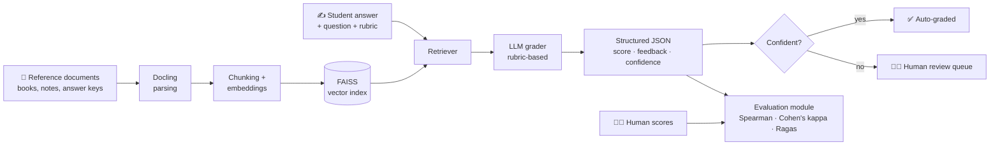

<div align="center">

# 🎓 EvalGrade

### RAG-based grading of subjective answers — with proof that the grades can be trusted

*Most AI graders stop at "the LLM gave a score". EvalGrade also measures how closely that score agrees with human graders, and sends doubtful answers to a human.*

<br>


[Why](#-why-evalgrade) · [How it works](#-how-it-works) · [Features](#-features) · [Evaluation](#-how-trust-is-measured) · [Quickstart](#-quickstart) · [Roadmap](#-roadmap) · [FAQ](#-faq)

</div>

---

> **📌 Project status — please read**
> EvalGrade is **in active development**. This README describes the **design and goals** of the project.
> The checklist in [Current Status](#-current-status) shows what is actually implemented.
> Numbers in the results tables are filled in **only after real measurement**.

---

## 🧭 Why EvalGrade?

Grading free-text answers (short answers, explanations, essays) is slow, tiring and inconsistent between graders. LLMs can score answers quickly, but a score alone is not enough:

| Problem with a plain "ask the LLM" grader | What EvalGrade does about it |
|---|---|
| The grader may ignore the reference material | Retrieves relevant reference passages first (RAG) |
| Scores can change between runs | Uses a fixed rubric and structured JSON output |
| Nobody knows if the scores are *good* | Compares scores against human graders with standard statistics |
| Wrong grades reach students silently | Flags low-confidence answers for human review |
| Prompt changes are judged by gut feeling | Compares each version against a baseline on the same labelled set |

---

## 🔧 How it works



### Step by step

1. **Parse** – Reference material and answer sheets (PDF, DOCX, scans) are converted into clean structured text with [Docling](https://github.com/docling-project/docling).
2. **Index** – Text is split into chunks, embedded, and stored in a [FAISS](https://github.com/facebookresearch/faiss) index.
3. **Retrieve** – For each question, the most relevant reference passages are fetched.
4. **Grade** – An LLM scores the student's answer against a rubric, using the retrieved passages as evidence, and returns structured JSON.
5. **Check confidence** – Answers where the grader is unsure are routed to a human instead of being auto-graded.
6. **Evaluate** – Scores are compared with human grades, and the retrieval/answer quality is measured with [Ragas](https://github.com/vibrantlabsai/ragas).

---

## ✨ Features

| | Feature | What it means |
|---|---|---|
| 📄 | **Document parsing** | Turns PDFs and documents into structured text for indexing |
| 🔎 | **Retrieval-grounded grading** | The grader sees reference evidence, not just the question |
| 📝 | **Rubric-based scoring** | Each criterion is scored separately and added up |
| 🧾 | **Structured output** | JSON with score, per-criterion marks, feedback and confidence |
| 📊 | **Human-agreement metrics** | Spearman correlation and Cohen's kappa against human graders |
| 🚦 | **Low-confidence flagging** | Uncertain grades go to a review queue |
| 🧪 | **Baseline comparison** | Simple prompt vs. full pipeline on the same labelled set |
| 🔌 | **REST API** | Grade answers through HTTP endpoints (FastAPI) |
| 🐳 | **Docker** | One-command setup |

> Not every feature above is built yet. See [Current Status](#-current-status).

---

## 📐 Planned output format

Each graded answer is intended to return a structured result like this (illustrative example — update it to match the final schema):

```json
{
  "question_id": "Q12",
  "total_score": 7.5,
  "max_score": 10,
  "criteria": [
    { "name": "Correct definition", "score": 3, "max": 3, "evidence": "chunk_41" },
    { "name": "Example given",      "score": 2, "max": 3, "evidence": "chunk_44" },
    { "name": "Clear explanation",  "score": 2.5, "max": 4, "evidence": null }
  ],
  "feedback": "Definition is correct. Add a concrete example for full marks.",
  "confidence": 0.62,
  "needs_human_review": true
}
```

---

## 📏 How trust is measured

This is the core idea of the project. A grade is only useful if people can rely on it.

| Metric | Plain-English meaning | Why it is used |
|---|---|---|
| **Spearman correlation** | Do the AI and the human *rank* answers in a similar order? | Shows whether better answers get higher scores |
| **Cohen's kappa** | How often do AI and human agree, *beyond chance*? | More honest than raw accuracy |
| **Mean absolute error** | Average gap between AI mark and human mark | Shows the size of typical mistakes |
| **Review rate** | Share of answers flagged for a human | Shows the cost of staying safe |
| **Retrieval / faithfulness (Ragas)** | Did the grader use the right evidence and stay faithful to it? | Detects hallucinated justifications |

### 📊 Results

| Item | Value |
|---|---|
| Evaluation set size | `[280]` human-scored answers |
| Number of human graders | `[3]` |
| Spearman correlation | `[0.80]` |
| Cohen's kappa | `[0.75]` |
| Mean absolute error | `[7%]` |
| Baseline (simple prompt) kappa | `[+0.10]` |
| Answers flagged for review | `[15%]` |

**Known limitations:** `[e.g. small evaluation set, one subject area, score variance between runs]`

---

## 🚀 Quickstart

```bash
git clone https://github.com/vivekkumarm09/EvalGrade.git
cd EvalGrade

python -m venv venv
source venv/bin/activate        # Windows: venv\Scripts\activate

pip install -r requirements.min.txt   # check this file lists EvalGrade's dependencies
```

Set credentials as environment variables (never commit keys):

```bash
export OPENAI_API_KEY="your-key"      # or the key for whichever model you use
```

> Commands for running the pipeline and API will be added here once they exist.

---

## 🗂 Project structure

```
EvalGrade/
├── evalgrade/            # core package: parsing, retrieval, grading, evaluation   [planned]
├── api/                  # FastAPI application                                     [planned]
├── data/                 # sample, non-confidential data only                      [planned]
├── rubrics/              # example rubrics                                         [planned]
├── tests/                # pytest tests                                            [planned]
├── pyproject.toml        # packaging and tooling configuration
├── requirements.min.txt  # runtime dependencies
├── requirements.dev.txt  # development dependencies
└── README.md
```

---

## ✅ Current status

Tick a box only when the feature works in this repository.

- [ ] Document parsing with Docling
- [ ] Chunking, embeddings and FAISS index
- [ ] Rubric-based LLM grader with JSON output
- [ ] Human-labelled evaluation set
- [ ] Spearman and Cohen's kappa evaluation
- [ ] Baseline vs. EvalGrade comparison
- [ ] Ragas retrieval / faithfulness evaluation
- [ ] Low-confidence flagging
- [ ] FastAPI endpoints
- [ ] Automated tests and CI
- [ ] Docker image

---

## 🛣 Roadmap

| Phase | Goal | Done when |
|---|---|---|
| 1 | Parse documents and build the index | Sample documents load and can be searched |
| 2 | Build the rubric grader | JSON output is valid for all test answers |
| 3 | Create the human-labelled set | `[N]` answers scored by humans |
| 4 | Add evaluation metrics | Spearman and kappa computed automatically |
| 5 | Add confidence and review flagging | Flagged answers are exported for review |
| 6 | API, tests, Docker | `pytest` passes; container runs |

---

## 🔒 Data and privacy

- Only **public or synthetic** data belongs in this repository.
- No confidential employer, student or institutional data is committed.
- API keys are read from environment variables and never stored in the repo.

---

## ❓ FAQ

<details>
<summary><b>Can an AI grader fully replace human graders?</b></summary>
No. EvalGrade is built around that fact: it measures agreement with humans and sends uncertain answers to a human reviewer.
</details>

<details>
<summary><b>Why Cohen's kappa instead of accuracy?</b></summary>
Accuracy can look high just by chance, especially when most answers get similar marks. Kappa corrects for chance agreement.
</details>

<details>
<summary><b>Why use retrieval at all?</b></summary>
It gives the grader the actual reference material, so marks are justified by evidence instead of the model's memory.
</details>

<details>
<summary><b>Is the live demo available?</b></summary>
Not yet. A link will be added here once the project is deployed.
</details>

---

## 🤝 Contributing

Issues and pull requests are welcome. Please open an issue first to discuss large changes.

## 🙏 Acknowledgements

EvalGrade is built on open-source projects. Please check each repository for current license terms.

- [Docling](https://github.com/docling-project/docling) — document parsing (MIT)
- [Ragas](https://github.com/vibrantlabsai/ragas) — RAG evaluation (Apache-2.0)
- [FAISS](https://github.com/facebookresearch/faiss) — vector similarity search
- [Evidently](https://github.com/evidentlyai/evidently) — optional monitoring (Apache-2.0)

---

<div align="center">

**Built by [Vivek Kumar Mishra](https://github.com/vivekkumarm09)** · If this project helps you, consider giving it a ⭐

</div>

